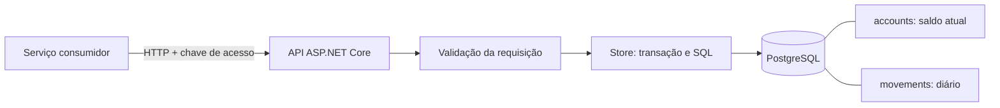
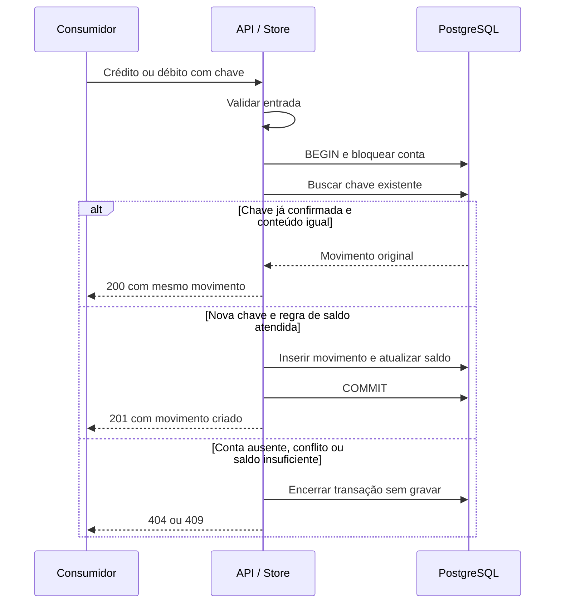

# Decisões de arquitetura e operação

## Visão geral e responsabilidades

O consumidor conhece a intenção de negócio e fornece sua chave idempotente. A API transforma HTTP em chamadas da aplicação e traduz erros em respostas. O `Store` coordena persistência e regras que dependem do estado da conta. O PostgreSQL arbitra a concorrência entre processos: um bloqueio apenas em memória não protegeria duas réplicas da API.

| Componente | Por que existe | Limite da responsabilidade |
| --- | --- | --- |
| `Program.cs` | Configurar dependências, limite de concorrência e endpoints | Não faz cálculo de saldo ou SQL de movimentação; a chave compartilhada não autoriza por conta |
| `ApiMiddleware.cs` e `HistoryInstant.cs` | Centralizar autenticação, falhas de persistência e validação explícita do instante histórico | Chave de serviço ainda não distingue titulares |
| `Domain.cs` | Definir contratos, validação monetária e erro de negócio | Ainda não há entidade de cliente, transferência ou regras contábeis completas |
| `Store.cs` | Manter bloqueio, verificação e gravação na mesma transação | Reúne regras dependentes de saldo e SQL; separar quando houver complexidade que justifique |
| `schema.sql` | Formalizar precisão, relações, unicidade e índice de histórico | Bootstrap inicial, não ferramenta de migração nem proteção contra administrador |
| Suíte `Ledger.Tests` | Verificar invariantes, HTTP, falhas e concorrência usando o banco real | Não simula failover, desastre ou rede interrompida durante commit |
| `compose.yaml` e `Dockerfile` | Tornar ambiente e empacotamento reproduzíveis | Configuração de desenvolvimento; não representa infraestrutura de alta disponibilidade |
| `ci.yml` e `Directory.Build.props` | Repetir build/testes e impedir aprovação com warnings | Não mede carga, segurança operacional ou recuperação |

## Modelo de dados: por que guardar diário e saldo

`movements` responde “quais registros compõem esta posição?”. Cada linha guarda identificador, conta, chave, valor, direção e horário. O valor é sempre positivo; a direção define o sinal. A chave estrangeira impede movimento sem conta e a restrição única impede repetir a chave na mesma conta.

`accounts` responde “qual é o saldo agora?”. Seu campo `balance` é uma projeção síncrona do diário, mantida na mesma transação. Essa duplicação reduz o custo da leitura atual, mas cria uma obrigação: nenhum caminho de escrita pode atualizar apenas um dos lados. A consulta histórica usa o diário, porque uma única coluna de saldo não preservaria a evolução da conta.

O índice `(account_id, recorded_at)` aproxima o acesso do filtro histórico e inclui valor/tipo, mas não torna a soma constante: uma conta com muitos registros ainda exige ler muitos itens. O índice também custa espaço e manutenção em cada escrita. A precisão do saldo (`numeric(20,2)`) é maior que a de cada movimento (`numeric(18,2)`) para permitir acumulação, com limite explícito na aplicação.

## Exemplo de concorrência e repetição

Imagine saldo de R$ 100 e dois débitos simultâneos de R$ 80. Sem coordenação, ambos poderiam ler 100 e ser aprovados. Com o bloqueio da linha, o primeiro confirma saldo 20; o segundo só então lê 20 e é recusado. Essa espera é deliberada: protege a regra de saldo, ao custo de limitar a vazão de uma única conta.

Se a resposta do primeiro débito se perder, uma repetição com a mesma chave recupera o movimento original. A verificação da chave ocorre antes da nova avaliação de saldo: a repetição não deve ser recusada só porque a operação original já gastou o dinheiro.

No retorno de uma duplicata, o descarte da transação encerra a leitura e libera o bloqueio; não existe nova escrita a confirmar. Uma falha durante a nova gravação antes do commit não deixa um lançamento parcialmente aplicado. Uma falha de comunicação durante o commit deixa o resultado incerto para o consumidor, resolvido pela repetição idempotente.

## Alternativas e custos assumidos

| Escolha atual | Alternativa considerada | Motivo e custo assumido |
| --- | --- | --- |
| Aplicação única | Microserviços por responsabilidade | Menos saltos e falhas distribuídas; deploy e escala continuam acoplados |
| Bloqueio pessimista por conta | Versão otimista com retries | Fluxo simples para saldo disputado; pode haver espera e timeout em conta concentradora |
| Saldo atual materializado na transação | Somar diário em toda leitura | Leitura atual barata; exige manter e reconciliar duas representações |
| Histórico síncrono no primário | Réplica/cache/projeção assíncrona | Evita apresentar atraso como posição atual; aumenta carga no primário |
| Diário simples com projeção | Event sourcing completo | Preserva registros sem infraestrutura de replay e versionamento de eventos; não oferece todas as garantias de auditoria de uma plataforma contábil |
| SQL explícito com Npgsql | ORM | Deixa bloqueio e transação visíveis; requer manter SQL e mapeamento manualmente |
| Arquivos com funções definidas | Vários projetos e interfaces por camada | Menos indireção nesta escala; evoluir a separação quando regras e integrações crescerem |

Essas escolhas não provam superioridade em qualquer cenário. O enunciado não informa volume, distribuição por conta, latência esperada ou orçamento; por isso a proposta explica mecanismos e gargalos, sem declarar capacidade numérica.

## Uma aplicação e um banco relacional

ASP.NET Core mantém a superfície pequena e usa I/O assíncrono. PostgreSQL é a fonte de verdade. Uma transação engloba o diário e o saldo materializado, evitando atualização dupla entre serviços. Microserviços, mensageria e cache de saldo foram adiados: aumentariam a superfície de falhas sem requisito que justifique consistência eventual. .NET 10 é LTS. O acesso explícito via Npgsql torna o SQL e o escopo transacional revisáveis.

Referências: [suporte .NET](https://dotnet.microsoft.com/en-us/platform/support/policy), [Npgsql](https://www.npgsql.org/doc/basic-usage.html).

## Consistência e concorrência

1. Validar entrada antes da transação.
2. Bloquear a linha da conta com `FOR UPDATE`.
3. Procurar chave idempotente e comparar o conteúdo original.
4. Verificar saldo e limites, inserir movimento e atualizar saldo.
5. Confirmar ambos atomicamente antes de responder.

READ COMMITTED com bloqueio por conta evita perdas de atualização e gasto concorrente do mesmo saldo. Contas diferentes não compartilham esse bloqueio. A restrição única por conta/chave reforça a idempotência no banco. Operações abortadas liberam o bloqueio por descarte da transação. A repetição de um movimento já confirmado devolve o registro original antes de avaliar o saldo atual.

Se a confirmação ocorreu e a resposta se perdeu, a mesma chave recupera o resultado. Não se promete entrega exatamente uma vez na rede. Não há retry automático de escrita com resultado ambíguo. O cliente repete com a mesma chave e backoff com jitter, limitado por prazo e número de tentativas.

`numeric` e `decimal` evitam arredondamento binário. O banco também valida valores positivos, tipo e saldo não negativo. A consulta atual usa a linha da conta; a histórica soma o diário usando índice por conta/data. Uma instrução SQL garante uma fotografia consistente. O horário vem do banco após adquirir o bloqueio. NTP e monitoramento de relógio continuam necessários; o horário é de registro, não de commit nem de validade econômica externa.

## Falhas e alta demanda

Em indisponibilidade do banco, retornar 503 sem aceitar lançamentos apenas em memória. A disponibilidade de escrita depende do primário: prioriza-se consistência financeira. O pool limita conexões, mas não substitui controle de admissão. A API limita a concorrência de contas por instância (32 por padrão, sem fila) e retorna 429 ao exceder. A espera de lock em movimentações é limitada a 3 segundos. Antes de produção, ajustar esses valores com medições e complementar com limites de requisição e rate limiting no gateway. Escalar réplicas stateless da API; a conta muito concorrida continua sendo um ponto serial por definição da regra de saldo.

Consultas históricas crescem com o diário. Medir volume e latência antes de introduzir snapshots, particionamento ou projeções. Projeções assíncronas devem expor seu ponto de atualização; não responder como se fossem saldo autoritativo. Se houver eventos, usar outbox transacional e consumidores idempotentes.

## Segurança

A API exige chave de serviço e falha ao iniciar sem configuração. A comparação usa hashes de tamanho fixo em tempo constante. Não há logs de corpo, credencial ou dados financeiros. SQL parametrizado evita interpolação de entrada. O exemplo mantém portas do host em loopback e executa a API como usuário sem privilégios no contêiner.

Antes de produção: TLS entre cliente/gateway/API/banco, autenticação OIDC/mTLS por serviço, autorização por conta/escopo, rotação de segredos via cofre, criptografia de discos/backups, auditoria com acesso restrito, política de retenção/LGPD e gestão de incidentes. UUID não é autorização. O usuário PostgreSQL do Compose é de desenvolvimento; criar papel de runtime sem DDL e sem UPDATE/DELETE no diário, e papel separado para migrações. O diário é protegido pela API e pelo trigger da migração 002 contra UPDATE, DELETE e TRUNCATE. Um administrador pode remover o trigger; papéis restritos continuam necessários.

## Operação e próximos passos

- Migrar schema por etapa de implantação, com compatibilidade entre versões e papel dedicado.
- Alta disponibilidade PostgreSQL, política de failover e durabilidade de réplica explicitamente escolhida. Não promover réplica atrasada sem analisar perda de dados.
- Backup contínuo/PITR e ensaios de restauração; definir RPO/RTO com negócio.
- Monitorar p95/p99, erros, timeouts, saturação do pool, espera de locks e atraso de réplica. Acrescentar tracing/OpenTelemetry sem payload sensível.
- Reconciliar periodicamente saldo materializado com soma do diário em snapshot consistente; divergência exige investigação, não reparo silencioso.
- Executar ensaio de carga com contas distribuídas e conta concentradora; testar queda de conexão no commit, reinício do primário e disco cheio.
- Implementar partidas dobradas e contas contábeis caso o sistema assuma papel de razão contábil; esta API registra movimentos de clientes, não substitui contabilidade completa.

Não há benchmark ou evidência de capacidade para tráfego de produção nesta entrega. Os testes atuais verificam invariantes com PostgreSQL real; failover, restauração e carga precisam de ambiente próprio.

## Limitações observáveis nesta versão

- O readiness faz uma leitura limitada da tabela de contas; não prova permissões de escrita, existência do trigger ou todas as estruturas.
- A chave compartilhada não fornece autenticação individual, autorização por conta, trilha de auditoria de acesso ou rotação automática.
- O trigger protege o diário de mutações acidentais, mas não impede um administrador de removê-lo nem impede escrita externa divergente no saldo.
- A migração 002 é SQL transacional reaplicável; ainda não há executor com histórico de versões e checksums. Deve ser aplicada explicitamente a volumes existentes.
- O limite de concorrência é por processo e não constitui quota distribuída. Health checks estão fora dele; precisam de proteção de rede no ambiente real.
- Não há endpoint de extrato, reconciliação automática, vínculo de estorno, transferência atômica entre contas ou razão de partidas dobradas.
- Os testes de falha não simulam perda de conexão durante o commit, failover ou restauração de backup.

A [revisão da solução](improvements.md) detalha as melhorias implementadas e suas evidências. A [matriz de requisitos](requirements.md) relaciona a cobertura ao desafio.
